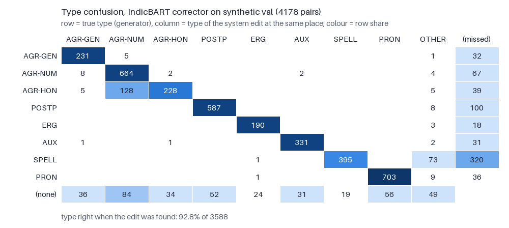

# Final results — IndicBART corrector vs System A

Produced by `.venv\Scripts\python.exe scripts\19_phase_e.py` from saved system outputs (reports/predictions/). HiWikEd-bio test was decoded once per system (18_final_test.py, 16_baseline_A.py --final-test) after every choice was made on dev_select and synthetic val. Edit-level scores with the hallucination guard on, β = 0.5.

## HiWikEd-bio test (1,823 pairs)

| system | P | R | F0.5 all edits | F0.5 7 types | F0.5 + PRON | GLEU | exact match |
|---|---|---|---|---|---|---|---|
| IndicBART corrector | 0.627 | 0.325 | **0.529** | 0.505 | 0.576 | 0.7880 | 27.8% |
| System A | 0.392 | 0.155 | **0.300** | 0.266 | 0.337 | 0.7304 | 12.3% |
| do nothing (unchanged source) | | | | | | 0.7095 | |

## HiWikEd-bio dev_select (304 pairs)

| system | P | R | F0.5 all edits | F0.5 7 types | F0.5 + PRON | GLEU | exact match |
|---|---|---|---|---|---|---|---|
| IndicBART corrector | 0.644 | 0.346 | **0.549** | 0.540 | 0.604 | 0.7863 | 29.3% |
| System A | 0.354 | 0.157 | **0.283** | 0.258 | 0.318 | 0.7216 | 11.2% |
| do nothing (unchanged source) | | | | | | 0.7004 | |

## synthetic val (4,178 pairs)

| system | P | R | F0.5 all edits | F0.5 7 types | F0.5 + PRON | GLEU | exact match |
|---|---|---|---|---|---|---|---|
| IndicBART corrector | 0.850 | 0.798 | **0.839** | 0.809 | 0.839 | 0.9428 | 75.0% |
| System A | 0.677 | 0.532 | **0.642** | 0.596 | 0.642 | 0.8652 | 46.7% |
| do nothing (unchanged source) | | | | | | 0.7524 | |

## Per error type, HiWikEd-bio test (corrector, 8-type classifier)

| type | TP | FP | FN | F0.5 |
|---|---|---|---|---|
| AGR-GEN | 40 | 36 | 55 | 0.501 |
| AGR-NUM | 118 | 79 | 147 | 0.560 |
| AGR-HON | 76 | 41 | 76 | 0.613 |
| POSTP | 69 | 56 | 172 | 0.466 |
| ERG | 0 | 9 | 0 | 0.000 |
| AUX | 43 | 26 | 102 | 0.511 |
| SPELL | 96 | 27 | 109 | 0.689 |
| PRON | 178 | 57 | 116 | 0.721 |
| OTHER | 0 | 45 | 0 | 0.000 |

## Type confusion (synthetic val)

When the corrector found an error it gave it the right type 92.8% of the time (3,588 found of 4,231 reference edits).

## Latency (full app pipeline, 100 dev_select sentences, each setting timed 3x)

| device | 1 sentence: mean | p95 | batch of 16: mean per sentence | p95 |
|---|---|---|---|---|
| cuda | 138.3 ms | 199.4 ms | 25.1 ms | 52.6 ms |

## Error analysis: 20 random test failures

Note counts: missed 18, spurious 4, wrong fix 2.

1. `hwe_00111` — missed AGR-NUM
   - source: हृथिक रोशन ( हिन्दी ऋतिक रोशन , उच्चारण 10 जनवरी 1974 जन्म ) एक भारतीय अभिनेता है जो बॉलीवुड में काम कर रहे है ।
   - output: हृथिक रोशन ( हिन्दी ऋतिक रोशन , उच्चारण 10 जनवरी 1974 जन्म ) एक भारतीय अभिनेता है जो बॉलीवुड में काम कर रहे है ।
   - target: हृथिक रोशन ( हिन्दी ऋतिक रोशन , उच्चारण 10 जनवरी 1974 जन्म ) एक भारतीय अभिनेता है जो बॉलीवुड में काम कर रहे हैं ।
2. `hwe_00115` — missed POSTP
   - source: वे कहते थे कि शिक्षा केवल पुस्तकों में सीखना और तथ्यों को कंठस्थ करना मात्र नहीं है ।
   - output: वे कहते थे कि शिक्षा केवल पुस्तकों में सीखना और तथ्यों को कंठस्थ करना मात्र नहीं है ।
   - target: वे कहते थे कि शिक्षा केवल पुस्तकों से सीखना और तथ्यों को कंठस्थ करना मात्र नहीं है ।
3. `hwe_00130` — missed POSTP
   - source: एम ए चिदंबरम स्टेडियम चेन्नई में एक प्रसिद्ध क्रिकेट स्टेडियम है ।
   - output: एम ए चिदंबरम स्टेडियम चेन्नई में एक प्रसिद्ध क्रिकेट स्टेडियम है ।
   - target: एम ए चिदंबरम स्टेडियम चेन्नई के एक प्रसिद्ध क्रिकेट स्टेडियम है ।
4. `hwe_00141` — missed SPELL
   - source: दादा ने कुछ करने का आश्वासन दिया , परंतु दुर्भाग्य से महीने भर बाद ही उनकी सरकार गिर गयी ।
   - output: दादा ने कुछ करने का आश्वासन दिया , परंतु दुर्भाग्य से महीने भर बाद ही उनकी सरकार गिर गयी ।
   - target: दादा ने कुछ करने का आश्वासन दिया , परंतु दुर्भाग्य से महीने भर बाद ही उनकी सरकार गिर गई ।
5. `hwe_00358` — missed OTHER; spurious AGR-HON
   - source: उनके दो पुत्र और एक पुत्री है ।
   - output: उनके दो पुत्र और एक पुत्री हैं ।
   - target: उनके एक पुत्र और एक पुत्री है ।
6. `hwe_00384` — missed OTHER
   - source: फोटोग्राफी का काम मुख्य रूप से दिसंबर 2009 और जनवरी 2010 में लन्दन और ब्रिटेन के अन्य स्थानों में किया गया ।
   - output: फोटोग्राफी का काम मुख्य रूप से दिसंबर 2009 और जनवरी 2010 में लन्दन और ब्रिटेन के अन्य स्थानों में किया गया ।
   - target: फोटोग्राफी का काम मुख्य रूप से नवंबर 2009 और जनवरी 2010 में लन्दन और ब्रिटेन के अन्य स्थानों में किया गया ।
7. `hwe_00437` — missed AGR-HON; spurious POSTP
   - source: उनके ग्रंथों में कविताएं , नाटक , शोध निबंध , टीकाएं , प्रवचन , और स्वयं की संगीतिक सर्जन सम्मिलित है ।
   - output: उनके ग्रंथों में कविताएं , नाटक , शोध निबंध , टीकाएं , प्रवचन , और स्वयं का संगीतिक सर्जन सम्मिलित है ।
   - target: उनके ग्रंथों में कविताएं , नाटक , शोध निबंध , टीकाएं , प्रवचन , और स्वयं की संगीतिक सर्जन सम्मिलित हैं ।
8. `hwe_00482` — spurious PRON
   - source: वहां उसे थार्क्स और उनका जेडाक ( मुखिया ) तार्स तार्कास बंदी बना लेते है ।
   - output: वहां उन्हें थार्क्स और उनका जेडाक ( मुखिया ) तार्स तार्कास बंदी बना लेते हैं ।
   - target: वहां उसे थार्क्स और उनका जेडाक ( मुखिया ) तार्स तार्कास बंदी बना लेते हैं ।
9. `hwe_00631` — missed OTHER
   - source: 2012 के रूप में , अमरीकी 378 मिलियन का कुल वेतन पैकेज कुक को दुनिया में सबसे अधिक वेतन पाने वाला सीईओ बनाता है ।
   - output: 2012 के रूप में , अमरीकी 378 मिलियन का कुल वेतन पैकेज कुक को दुनिया में सबसे अधिक वेतन पाने वाला सीईओ बनाता है ।
   - target: 2012 के रूप में , अमरीकी 378 मिलियन का कुल वेतन पैकेज कुक को दुनिया में सबसे सर्वाधिक वेतन पाने वाला सीईओ बनाता है ।
10. `hwe_01005` — missed OTHER; missed AGR-NUM
   - source: भीमसिंह चौहान राजस्थान राज्य के सवाई माधोपुर जिले की चौथ का बरवाड़ा तहसील में स्थित चौथ माता मंदिर की स्थापना करने वाला शासक था ।
   - output: भीमसिंह चौहान राजस्थान राज्य के सवाई माधोपुर जिले की चौथ का बरवाड़ा तहसील में स्थित चौथ माता मंदिर की स्थापना करने वाला शासक था ।
   - target: भीमसिंह चौहान राजस्थान राज्य के सवाई माधोपुर जिले की चौथ का बरवाड़ा तहसील में स्थित चौथ माता मंदिर की स्थापना करने वाले शासक थे ।
11. `hwe_01025` — wrong fix AGR-HON
   - source: इनके अलावा ये 2014 में 2013 में आईपीएल की टीम रॉयल चैलेंजर्स बैंगलोर के लिए खेलते है ।
   - output: इनके अलावा ये 2014 में 2013 में आईपीएल की टीम रॉयल चैलेंजर्स बैंगलोर के लिए खेलते थे ।
   - target: इनके अलावा ये 2014 में 2013 में आईपीएल की टीम रॉयल चैलेंजर्स बैंगलोर के लिए खेलते हैं ।
12. `hwe_01086` — missed AUX
   - source: इसके अतिरिक्त वे एक शिक्षक और रूसी प्राकृतिक विज्ञान अकादमी के सदस्य हैं ।
   - output: इसके अतिरिक्त वे एक शिक्षक और रूसी प्राकृतिक विज्ञान अकादमी के सदस्य हैं ।
   - target: इसके अतिरिक्त वे एक शिक्षक और रूसी प्राकृतिक विज्ञान अकादमी के सदस्य थे ।
13. `hwe_01140` — missed AUX
   - source: अर्जुन बहादुर थापा ( जन्म 12 जनवरी 1956 ) नेपाली राजनयिक और दक्षिण एशियाई क्षेत्रीय सहयोग संगठन ( सार्क ) के महासचिव हैं ।
   - output: अर्जुन बहादुर थापा ( जन्म 12 जनवरी 1956 ) नेपाली राजनयिक और दक्षिण एशियाई क्षेत्रीय सहयोग संगठन ( सार्क ) के महासचिव हैं ।
   - target: अर्जुन बहादुर थापा ( जन्म 12 जनवरी 1956 ) नेपाली राजनयिक और दक्षिण एशियाई क्षेत्रीय सहयोग संगठन ( सार्क ) के महासचिव थे ।
14. `hwe_01252` — missed AGR-NUM
   - source: भारत की 2011 की जनगणना के अनुसार गांवो में 67 प्रतिशत और शहरो में 13 प्रतिशत परिवार खुले में शौच करते है ।
   - output: भारत की 2011 की जनगणना के अनुसार गांवो में 67 प्रतिशत और शहरो में 13 प्रतिशत परिवार खुले में शौच करते है ।
   - target: भारत की 2011 की जनगणना के अनुसार गांवो में 67 प्रतिशत और शहरो में 13 प्रतिशत परिवार खुले में शौच करते हैं ।
15. `hwe_01908` — wrong fix AGR-NUM
   - source: भारत की दूसरी भाषाओं की तरह गुजराती भाषा का जन्म संस्कृत भाषा से हुआ है ।
   - output: भारत की दूसरी भाषाओं की तरह गुजराती भाषा का जन्म संस्कृत भाषा से हुआ था ।
   - target: भारत की दूसरी भाषाओं की तरह गुजराती भाषा का जन्म संस्कृत भाषा से हुआ हैं ।
16. `hwe_02356` — missed OTHER
   - source: उन्होंने लंका को जलने के लिए वानर का रूप धरा था ।
   - output: उन्होंने लंका को जलने के लिए वानर का रूप धरा था ।
   - target: उन्होंने लंका को जलाने के लिए वानर का रूप धरा था ।
17. `hwe_02569` — missed OTHER
   - source: जेल में रहते हुए उनका अध्ययन बराबर जारी रहा ।
   - output: जेल में रहते हुए उनका अध्ययन बराबर जारी रहा ।
   - target: जेल में रहते हुए उनका अध्ययन लगातार जारी रहा ।
18. `hwe_02791` — missed OTHER
   - source: उनकी कलाकृतियों को तीन प्रमुख श्रेणियों में बाँटा जाता है ।
   - output: उनकी कलाकृतियों को तीन प्रमुख श्रेणियों में बाँटा जाता है ।
   - target: उनकी कलाकृतियों को तीन प्रमुख श्रेणियों में बाँटा गया है ।
19. `hwe_02830` — missed OTHER; spurious POSTP
   - source: 1884 में बने इस महल का महाराजा का नया महल भी कहा जाता है ।
   - output: 1884 में बने इस महल को महाराजा का नया महल भी कहा जाता है ।
   - target: 1884 में बने इस महल का महाराज का नया महल भी कहा जाता है ।
20. `hwe_03023` — missed OTHER
   - source: इस सूरह का दूसरे अनुवादकों द्वारा किया अनुवाद क़ुरआन प्रोजेक्ट पर देखें ।
   - output: इस सूरह का दूसरे अनुवादकों द्वारा किया अनुवाद क़ुरआन प्रोजेक्ट पर देखें ।
   - target: इस सूरह का प्रसिद्ध अनुवादकों द्वारा किया अनुवाद क़ुरआन प्रोजेक्ट पर देखें ।
